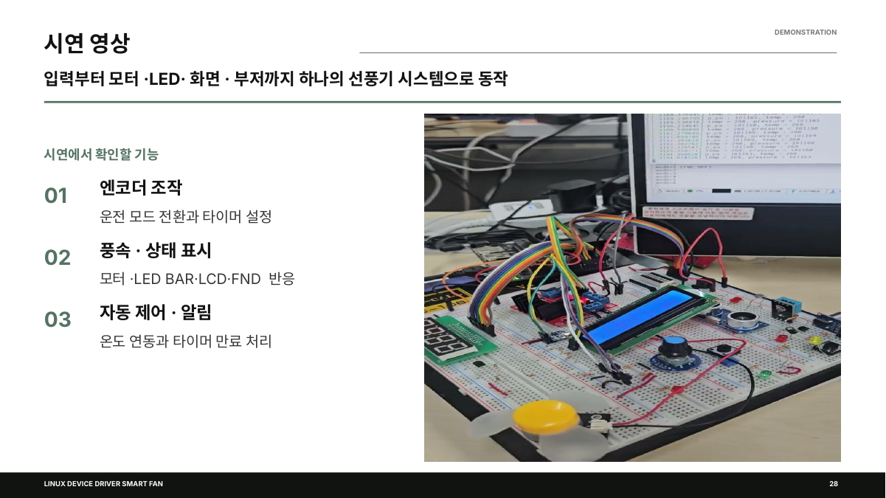
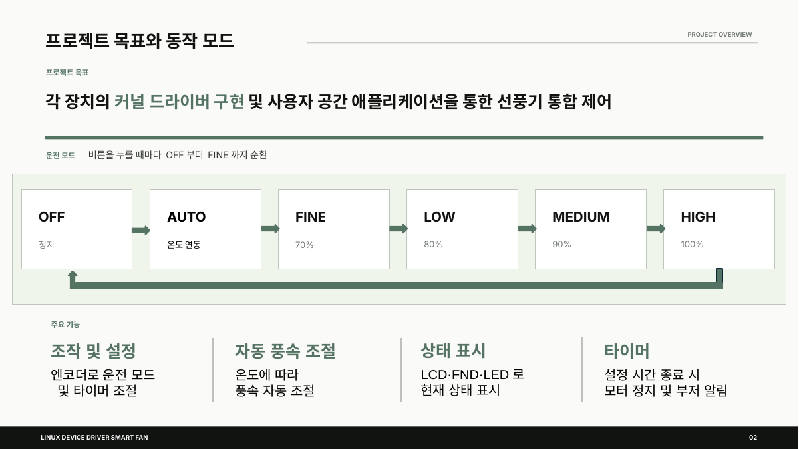
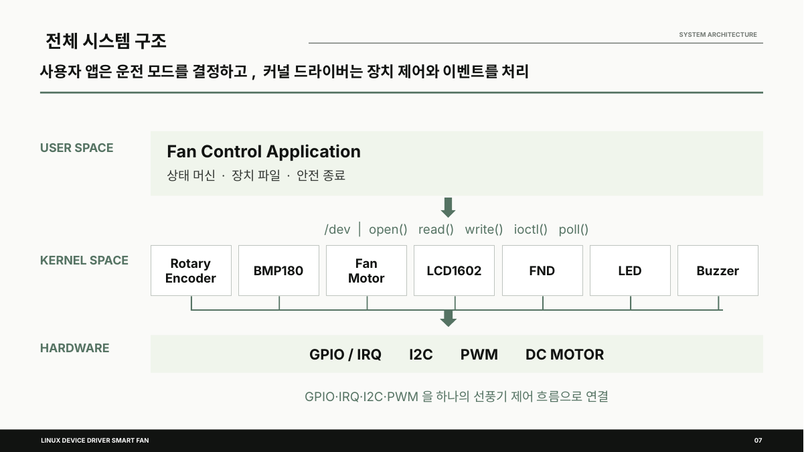
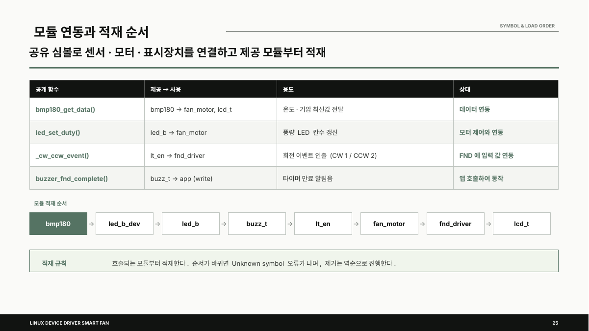
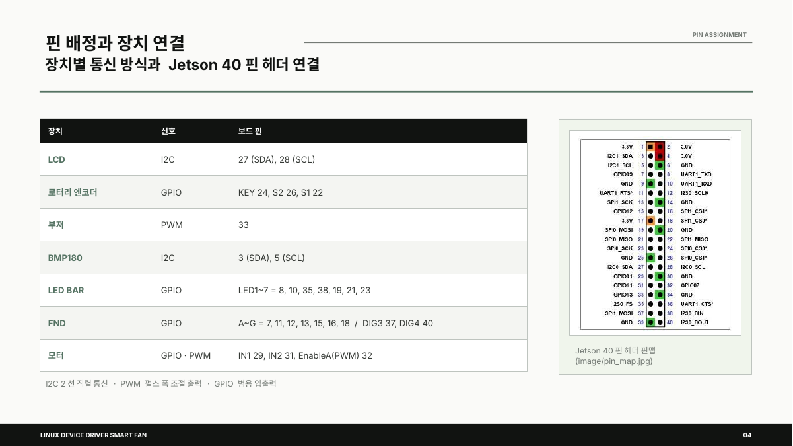
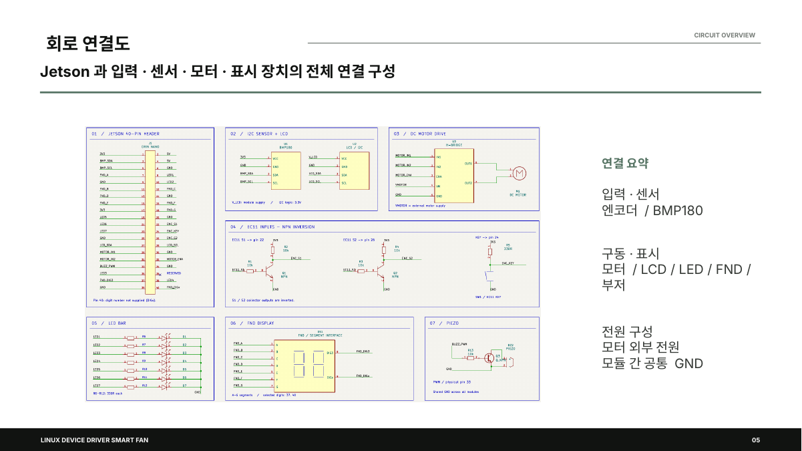

# 🌀 Linux Device Driver 기반 스마트 선풍기 (Jetson Orin Nano)

> 각 장치를 **리눅스 커널 드라이버**로 직접 구현하고, 사용자 공간 애플리케이션이 이를 하나로 묶어 선풍기를 제어하는 5인 팀 프로젝트입니다.
> 로터리 엔코더로 모드·타이머를 조작하고, 온도에 따라 풍속이 자동 조절되며, LCD·FND·LED로 상태를 표시하고, 타이머가 끝나면 모터가 멈추고 부저가 울립니다.
> *AI 시스템반도체 SW개발자 2기 (대한상공회의소) · 5조*



> 팀 전체 코드: [twotwoship/Linux_fan](https://github.com/twotwoship/Linux_fan) · 이 저장소는 **제가 담당한 LED BAR / BMP180 드라이버**와 프로젝트 정리본입니다.

## 👤 담당 역할 (김태환)

| 드라이버 | 장치 파일 | 내용 |
|---|---|---|
| **BMP180 온도·기압 센서** | `/dev/bmp180` | I2C(0x77) 드라이버, 보정계수 기반 온도·기압 계산, 1초 주기 측정 후 최신값을 다른 모듈에 공유 |
| **LED BAR** | `/dev/led_bar` | 모터 duty를 LED 칸 수로 변환해 표시 (platform device/driver 구조, 80ms 애니메이션) |

팀 구성: 권민지(Application · Buzzer), 김승환(Button Input · Fan Motor Control), 김태환(LED · BMP180), 이세형(Motor · FND Timer), 이양배(LCD · Rotary Encoder)

## ✨ 기능



| 기능 | 설명 |
|---|---|
| 운전 모드 | 엔코더 버튼을 누를 때마다 `OFF → AUTO → FINE(70%) → LOW(80%) → MEDIUM(90%) → HIGH(100%) → OFF` 순환 |
| 자동 풍속 | AUTO에서 BMP180 온도 구간별로 PWM duty 선택, 센서 오류 시 모터 정지(fail-safe) |
| 타이머 | 엔코더 회전으로 00~99분 설정(FND), 만료 시 모터 OFF + 부저 알림음 |
| 상태 표시 | LCD(온도·기압), 7세그먼트(타이머), LED BAR(풍량) |

## 🧩 시스템 구조



사용자 공간의 `fan_app`은 `open / read / write / ioctl / poll`로 장치 파일과 대화하고, 커널의 드라이버들이 GPIO·IRQ·I2C·PWM으로 하드웨어를 제어합니다. **앱은 "무엇을 할지"를 정하고, 드라이버는 "하드웨어 제어와 이벤트 처리"를 맡는** 역할 분리 구조입니다.

### 드라이버 간 연동 (커널 심볼 공유)

| 공개 함수 | 제공 → 사용 | 용도 |
|---|---|---|
| `bmp180_get_data()` | bmp180 → fan_motor, lcd_t | 온도·기압 최신값 전달 |
| `led_set_duty()` | led_b → fan_motor | 풍량 LED 칸 수 갱신 |
| `_cw_ccw_event()` | lt_en → fnd_driver | 엔코더 회전 이벤트 인출 |
| `buzzer_fnd_complete()` | buzz_t → app | 타이머 만료 알림음 |



호출되는 모듈부터 적재해야 합니다 (`bmp180 → led_b_dev → led_b → buzz_t → lt_en → fan_motor → fnd_driver → lcd_t`). 순서가 틀리면 `Unknown symbol` 오류가 나며, 제거는 역순입니다.

## 🔬 제가 구현한 드라이버

### BMP180 (`drivers/bmp180.c`)
- **Bus – Device – Driver 모델**: 디바이스 트리 없이 `module_init`에서 `i2c_new_client_device()`로 장치(버스 N, 주소 0x77)를 등록하고, `i2c_driver`의 `id_table` 이름이 같으면 `probe()` 호출
- `probe()`에서 **칩 ID(0xD0 = 0x55) 검증**, 보정계수 22바이트(11워드) 로드 및 `0`/`0xFFFF` 오류 검사
- 데이터시트 측정 순서(**온도 → 4.5ms 대기 → 압력**) 준수, 정수 연산만 사용(`temp_x10`, `pressure_pa`, 커널에서 float 금지)
- **1초 `delayed_work`**로 주기 측정 → 최신값 캐시. 모터·LCD는 센서에 직접 묻지 않고 캐시를 읽어 **I2C 경합과 응답 지연을 줄임**
- **동기화**: I2C 접근 순서는 `mutex`, 최신값 복사는 `spinlock`(온도·압력이 같은 측정의 짝으로 복사되도록)
- 값 공급 경로 2가지: `ioctl(BMP180_IOC_READ)`(호출 시 새로 측정) / `bmp180_get_data()`(캐시, `EXPORT_SYMBOL`)
- 제거 시 주기 작업을 먼저 `cancel_delayed_work_sync()`로 중단해 해제된 자원 접근 방지

### LED BAR (`drivers/led_b.c`, `led_b_dev.c`)
- `led_b_dev.ko`가 **platform device**(핀 번호는 `insmod` 인자 `gpios=`로 전달)를, `led_b.ko`가 **platform driver**를 담당. 이름 `led_bar`가 같으면 match → probe
- 모터가 계산한 duty(70/80/90/100%)를 LED 칸 수(1/3/5/7)로 변환하는 `duty_to_count()` 한 곳에서 매핑 관리
- `led_set_duty()`는 **목표값만 기록하고 즉시 리턴**, 실제 점등은 80ms 간격 `delayed_work`가 한 칸씩 이동 (가만히 있을 땐 작업이 돌지 않음)
- 모터는 `symbol_get(led_set_duty)`로 호출하므로 LED 모듈이 없어도 모터는 단독 동작
- 허용되지 않은 duty는 `-EINVAL`로 거부하고 LED 상태는 유지

## 🔌 하드웨어



| 장치 | 인터페이스 | 비고 |
|---|---|---|
| Jetson Orin Nano | – | Ubuntu 22.04, 커널 5.15.199-tegra, L4T R36.5.2, GCC 11.4.0 |
| LCD1602 (PCF8574) | I2C | 주소 0x27 |
| BMP180 | I2C | 주소 0x77 |
| EC11 로터리 엔코더 | GPIO(IRQ) | 20ms 디바운스, 16가지 전이 표로 회전 판정 |
| L298N + DC 모터 | GPIO + PWM | 20kHz PWM |
| 7세그먼트 FND | GPIO | 2자리 4ms 다중화 |
| LED BAR / 피에조 부저 | GPIO / PWM | |



## 🚀 빌드 및 실행

> Jetson에서 커널 헤더가 설치된 환경 기준입니다. 이 저장소의 `drivers/`는 제가 맡은 BMP180·LED 모듈만 포함하며, 전체 선풍기 구동은 팀 저장소의 통합 빌드를 사용하세요.

```bash
cd drivers
make

sudo insmod ./bmp180.ko bus=7        # i2cdetect -y -r 7 에서 0x77 확인
sudo insmod ./led_b_dev.ko gpios=458,459,401,400,483,482,481 active_low=0
sudo insmod ./led_b.ko
dmesg | tail                          # major 번호 확인
sudo mknod /dev/bmp180 c <major> 0
sudo mknod /dev/led_bar c <major> 0

# 제거 (역순)
sudo rmmod led_b led_b_dev bmp180
```

## 🛠 트러블슈팅

| 문제 | 해결 |
|---|---|
| BMP180 값을 LCD와 모터가 함께 읽어야 함 | 읽기 함수를 `EXPORT_SYMBOL`로 내보내고 **공용 헤더(`fan_common.h`)에 선언**해 모듈 간 계약을 통일 |
| 공유 심볼의 값 정의 불일치 (duty ↔ LED) | 통합 코드 매핑을 수정하고 70~100%를 1·3·5·7칸으로 정리 |
| 엔코더 입력 이상 / 모터가 LCD·I2C에 영향 | 입력 전압·방향 점검 후 NPN 반전 회로 추가, 외부 전원 사용 및 공통 GND 확인 |
| 통합 실행 시 타이머 미동작 | 타이머 종료 조건 논리 점검 및 속도 정의 재구성 |

검증은 `dmesg` 초기화 로그, `/dev` 장치 파일 생성, I2C 주소(i2cdetect), PWM duty, 입력부터 모터까지의 통합 동작 순으로 진행했습니다.

## 📚 배운 점

- 드라이버 하나를 잘 만드는 것보다 **다른 모듈과 값·적재 순서·인터페이스를 맞춰 연동**하는 것이 더 중요하다는 점
- 인터럽트에서는 이벤트만 기록하고 지연·반복 작업은 workqueue로 분리하는 커널 동시성 설계
- 데이터시트의 요구사항(주소, 타이밍, 보정식)을 코드 구조로 옮기는 과정

## 📄 문서

[발표 자료 (PDF)](docs/presentation.pdf)
